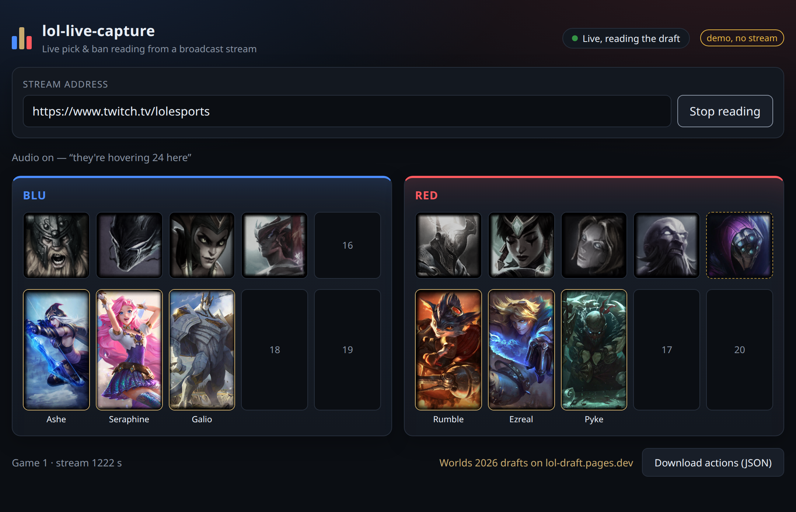
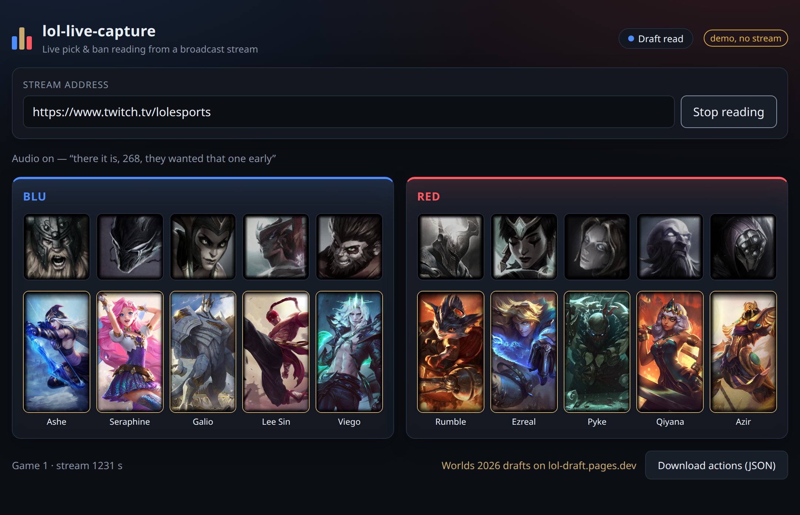
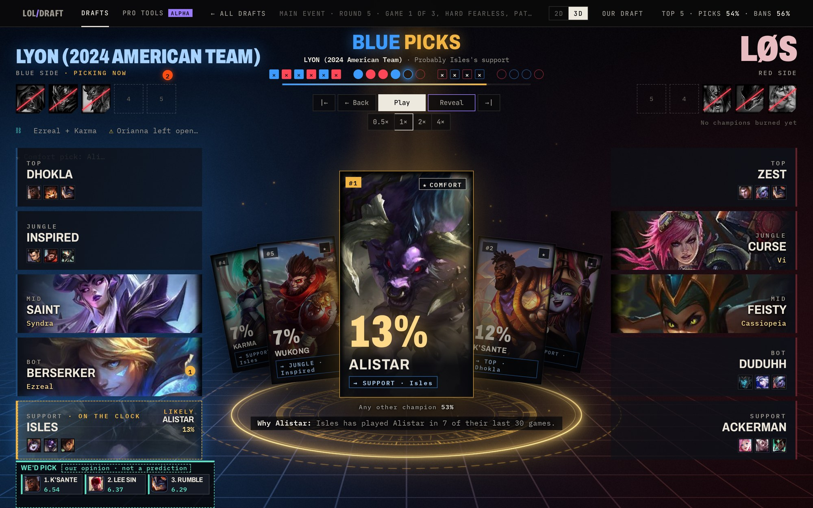
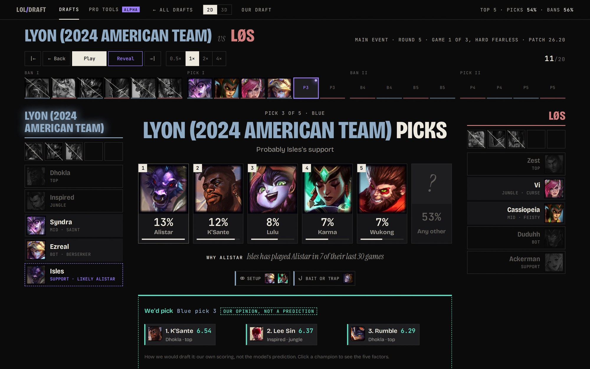

<div align="center">

# lol-live-capture

**Read a League of Legends pick/ban draft off a broadcast stream, live, as it happens.**

Computer vision on the champion-select overlay, optional caster audio to settle look-alikes, a lolesports cross-check
when the draft ends. Served as JSON, a server-sent event stream and a web UI.

[](LICENSE)


[](https://lol-draft.pages.dev)



</div>

## What you get

- **A live board.** Paste a YouTube or Twitch address and watch bans and picks lock in, with the champion currently
  hovered shown as a dashed ghost before it locks.
- **The 20 draft actions, in order.** Each has `sequence`, `side`, `action_type`, `champion_id`, `confidence` and `via`
  (`image`, `audio`, `turn`), so you can decide how much to trust it.
- **An API for your own tools.** `GET /api/capture/state`, or subscribe to `GET /api/capture/events` (SSE).
- **Replay.** Point it at a saved broadcast file and it plays at 1x like a stream.
- **Optional ears.** faster-whisper plus an optional LLM turn caster talk into champion mentions that break ties the
  image cannot.
- **A verdict.** After the draft it checks itself against the lolesports feed and says if they disagree.

<div align="center">

<br><sub>A finished draft in <code>/?demo</code> (an invented draft, no stream needed).</sub>
</div>

## How it works

```
stream (YouTube / Twitch / file) ──▶ frames ──▶ slot reads ──▶ tracker ──▶ CaptureState ──▶ API + SSE ──▶ UI
                               └──▶ audio ──▶ whisper ──▶ champion mentions ─┘
```

Frames come from `yt-dlp` and `ffmpeg` at 2 fps. Each overlay slot is cropped and matched against a reference bank of
champion art (SIFT features), and a tracker that knows the 20-action order commits a pick only when the draft moves
on, so a hover that changes its mind never gets recorded. The rules and the exact schema are in
[docs/contract.md](docs/contract.md).

## Does it work?

| Check | Result |
|---|---|
| Image only, 7 recorded Worlds drafts | **94.3%** of actions exact ([measured accuracy](docs/contract.md#measured-accuracy)) |
| End to end, KC vs MVK game 1, saved broadcast clip through the HTTP API | **20/20** exact against Leaguepedia |
| End to end, same game through the real YouTube URL (`yt-dlp` to `ffmpeg`) | **20/20** exact, draft complete at ~267 s |

Honest limits: the overlay layout is calibrated for the Worlds 2026 broadcast (`worlds-2026-1280x720-v1`), so other
broadcasts need their own layout in `layout.py`, and the audio path is covered by unit tests but was not part of
those end to end runs.

> **Status: early.** Expect rough edges and treat `confidence` and `via` as the trust signal.

## See it in use

This is the capture half of **[lol-draft](https://lol-draft.pages.dev)**, a Worlds 2026 draft lab. The site has every
Worlds 2026 game played so far with its verified draft, step by step, and what a frozen, pre-registered model
predicted at each pick before it happened. It also has a Pro tools page (live capture, live predictions, copilot, prep)
with an early-access list.

<div align="center">
<a href="https://lol-draft.pages.dev"></a>
<br><sub><b>3D view.</b> Before every pick or ban, the model's likeliest champions and the reason for each.</sub>
<br><br>
<a href="https://lol-draft.pages.dev"></a>
<br><sub><b>2D view.</b> The whole draft as a timeline you can step through, with what the team actually did next.</sub>
</div>

**<https://lol-draft.pages.dev>**

## Quick start

Needs Python 3.11+, `ffmpeg` on the PATH, and Node 20+ to build the UI.

```bash
python -m venv .venv && . .venv/bin/activate
pip install -e ".[dev]"           # add ".[audio]" for speech-to-text
lol-live-capture setup            # downloads champion art for the latest patch (~14 MB, ~1 min)
lol-live-capture serve            # http://127.0.0.1:8040
```

The UI has to be built once: `cd ui && npm install && npm run build` (writes into the Python package).
Open <http://127.0.0.1:8040>, paste a YouTube or Twitch address, press **Start reading**. `/?demo` runs the UI against
an invented draft with no stream.

Replay a saved broadcast: put the video under `~/.local/share/lol-live-capture/capture/` and paste its path.

Headless: `lol-live-capture run --source URL --state-file out.json` writes `CaptureState` to that file.

## API

All under `/api`; no authentication, so keep the default `127.0.0.1` bind (the API starts processes and reads files).

| | |
|---|---|
| `POST /capture/start` `{source, teams?}` | start the worker (YouTube/Twitch URL, or a file under the capture directory) |
| `POST /capture/stop` | stop it |
| `GET /capture/state` | current `CaptureState` |
| `GET /capture/events` | SSE, `event: state` on every change |
| `GET /champions`, `GET /champions/{ddragon_id}/{square\|loading}` | key → name and the downloaded art |
| `GET /health` | status and whether champion art is installed |

## Configuration

| Variable | Meaning |
|---|---|
| `LIVE_CAPTURE_HOME` | data directory (default `~/.local/share/lol-live-capture`) |
| `LIVE_CAPTURE_PYTHON` | interpreter for the worker, if it lives in its own venv |
| `LIVE_WHISPER_DEVICE` / `LIVE_WHISPER_MODEL` | `auto` (CUDA only), `cuda` or `cpu`; model override |
| `LIVE_LLM_API_KEY`, `LIVE_LLM_BASE_URL`, `LIVE_LLM_MODEL`, `LIVE_LLM_EXTRA_BODY` | optional LLM reading of the transcript (any OpenAI-compatible endpoint) |
| `LOLESPORTS_API_KEY` | override the lolesports public key |

## Development

```bash
pytest                      # backend; tests needing Riot footage or champion art skip without them
cd ui && npm test           # UI
cd ui && npm run dev        # UI on :5174, proxying /api to :8040
```

Recognizer and layout tests use broadcast stills kept out of the repository: put them in `tests/fixtures/private/`
(`s2520.jpg`, `holdout-*-band.jpg`) after running `setup`.

## License

MIT, see [LICENSE](LICENSE). Read [NOTICE.md](NOTICE.md) first: Riot's art, the unofficial lolesports API and stream
reading have terms of their own.
